# Compose Motion Icons

Icons that animate between states, written in pure Jetpack Compose and Compose Multiplatform.
A menu that crosses into an X, a heart that pops and throws sparks, a bell that rings as its badge
lands. One line each. No Lottie files, no AnimatedVectorDrawable XML, no assets.

[](https://jitpack.io/#zainkhalid91/compose-motion-icons)


[](LICENSE)

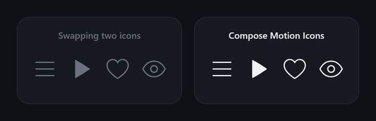

**[Try every icon in your browser](https://zainkhalid91.github.io/compose-motion-icons/)**: the
gallery is the library itself, running on the web.

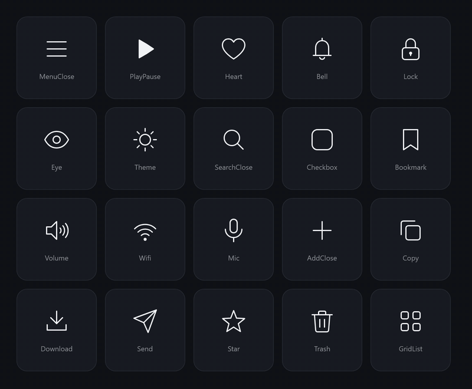

## Install

```kotlin
// settings.gradle.kts
dependencyResolutionManagement {
    repositories {
        maven("https://jitpack.io")
    }
}

// build.gradle.kts
dependencies {
    implementation("com.github.zainkhalid91.compose-motion-icons:icons:0.3.0")
}
```

Works on Android (minSdk 23), desktop and web (Wasm). Needs Kotlin 2.0 or newer and pulls in Compose 1.10 (your app's newer Compose wins).

## Use

Pass the state. The icon animates whenever it changes.

```kotlin
var liked by remember { mutableStateOf(false) }

IconButton(onClick = { liked = !liked }) {
    HeartIcon(liked = liked)
}

MenuCloseIcon(open = drawerState.isOpen)
PlayPauseIcon(playing = player.isPlaying)
EyeIcon(visible = showPassword)
VolumeIcon(level = volume)            // 0f..1f, waves follow the level
WifiIcon(strength = signal)           // 0f..1f, arcs light up one by one
EqualizerIcon(playing = isPlaying)    // bars dance while playing, settle when paused
```

Every icon takes `modifier`, `color`, `size`, `strokeWidth` and `contentDescription`, and icons
that light up take an accent (`activeColor`, `badgeColor`, `doneColor`).

## The icons

### Navigation

| | | | |
|:-:|:-:|:-:|:-:|
| 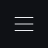<br>`MenuCloseIcon(open)` | <br>`SearchCloseIcon(active)` | <br>`AddCloseIcon(open)` | 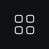<br>`GridListIcon(grid)` |

### Media

| | | | |
|:-:|:-:|:-:|:-:|
| <br>`PlayPauseIcon(playing)` | 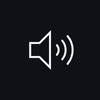<br>`VolumeIcon(level)` | 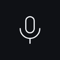<br>`MicIcon(muted)` | <br>`RecordIcon(recording)` |
| 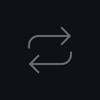<br>`RepeatIcon(enabled, one)` | 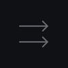<br>`ShuffleIcon(on)` | 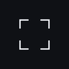<br>`FullscreenIcon(fullscreen)` | 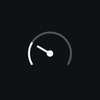<br>`SpeedIcon(level)` |
| 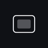<br>`PipIcon(pip)` | <br>`CastIcon(connected)` | 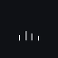<br>`EqualizerIcon(playing)` | |

### Camera

| | | | |
|:-:|:-:|:-:|:-:|
| <br>`CameraFlipIcon(front)` | <br>`ApertureIcon(open)` |  | |

### Social

| | | | |
|:-:|:-:|:-:|:-:|
| 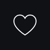<br>`HeartIcon(liked)` | 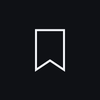<br>`BookmarkIcon(saved)` | <br>`SendIcon(sent)` | <br>`StarIcon(starred)` |
| <br>`ThumbUpIcon(liked)` |  |  | |

### Messaging

| | | | |
|:-:|:-:|:-:|:-:|
| <br>`MailIcon(open)` | <br>`PhoneIcon(inCall)` | <br>`TypingIcon(typing)` | 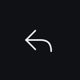<br>`ReplyIcon(all)` |

### Shopping

| | | | |
|:-:|:-:|:-:|:-:|
| <br>`CartIcon(count)` | <br>`FilterSortIcon(sort)` | <br>`GiftIcon(open)` | |

### Status

| | | | |
|:-:|:-:|:-:|:-:|
| 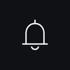<br>`BellIcon(badge)` | 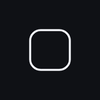<br>`CheckboxIcon(checked)` | <br>`WifiIcon(strength)` | <br>`CopyIcon(copied)` |
| 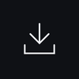<br>`DownloadIcon(done)` | 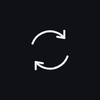<br>`SyncIcon(syncing)` | 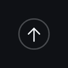<br>`UploadIcon(progress)` | |

### System

| | | | |
|:-:|:-:|:-:|:-:|
| <br>`LockIcon(locked)` | <br>`EyeIcon(visible)` | 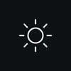<br>`ThemeIcon(dark)` | <br>`TrashIcon(open)` |

What each one does is in [ICONS.md](ICONS.md). 40 today, 50 on the way.

## Built for real screens

- **No animation on first appearance.** An icon starts in the state you give it. A list of
  already-liked posts doesn't burst into hearts as it scrolls into view; only a change animates.
- **Interruptible.** Tap twice quickly and the icon reverses from where it is, taking only the
  time the remaining distance needs. No jumps, no queued animations.
- **Cheap to draw.** Transitions are read in the draw phase, so a running icon redraws without
  recomposing, and paths and strokes are reused between frames.
- **Accessible.** Each icon has a state-aware description you can replace ("Like" / "Unlike",
  "Show password" / "Hide password", "Volume 60%"). `CopyIcon`, `DownloadIcon` and `SendIcon` are
  polite live regions, so screen readers hear "Copied". Pass `contentDescription = null` when
  the icon sits inside a button that already has a label.
- **Respects reduced motion.** With system animations off, icons switch instantly.
- **Sits with your other icons.** Everything is drawn on the 24 x 24 grid with a 2 dp rounded
  stroke, the same as Material Symbols Rounded and Lucide.
- **Works on any background.** Cut-outs (the checkbox tick, the badge gap, the slash through an
  eye) are real holes, not painted with a guessed background colour.

## Style

```kotlin
// One place for every icon on the screen.
ProvideMotionIconStyle(
    MotionIconStyle(
        color = MaterialTheme.colorScheme.onSurface,
        size = 24.dp,
        strokeWidth = 2.dp,
        speed = 1f, // 2f for twice as fast
    ),
) {
    AppScaffold()
}
```

## Screenshot tests

Wrap the screen in `FreezeMotionIcons` and icons jump straight to their state, so Paparazzi,
Roborazzi and Compose UI tests never capture one halfway through a morph:

```kotlin
paparazzi.snapshot { FreezeMotionIcons { PlayerScreen(playing = true) } }
```

## Run the gallery

```
./gradlew :gallery:run                          # desktop
./gradlew :gallery:wasmJsBrowserDevelopmentRun  # web
```

The GIFs and the demo video are rendered from the real library, frame by frame:
`./gradlew :gallery:recordFrames :gallery:recordDemoReel :gallery:recordBatchReel`, then
`tools/make-media.sh`.

## Roadmap

New icons land in weekly batches until there are 50: media controls, messaging, commerce, devices
and editing are next. The backlog and the rules that keep every icon's motion different are in
[ICONS.md](ICONS.md). Ideas and requests are welcome in the issues.

Loaders too? See [Compose Loaders](https://github.com/zainkhalid91/compose-loaders), 46 loading
indicators in the same style.

## License

MIT. See [LICENSE](LICENSE).
